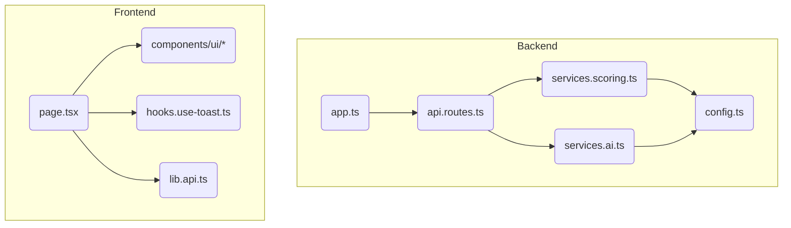

# Climate-Adaptive Architecture Tool (CAAT) – Onboarding Guide

## Table of Contents
1. [Welcome & Mission](#welcome--mission)
2. [High-Level Architecture Diagram](#high-level-architecture-diagram)
3. [Quick-Start Setup](#quick-start-setup)
4. [Tech Stack Crash Course](#tech-stack-crash-course)
5. [Key Code Walkthroughs](#key-code-walkthroughs)
6. [Environment & Secrets](#environment--secrets)
7. [Testing & Quality](#testing--quality)
8. [Common Dev Workflows](#common-dev-workflows)
9. [Troubleshooting FAQ](#troubleshooting-faq)
10. [Future Roadmap & First-Good-Issue List](#future-roadmap--first-good-issue-list)
11. [Glossary](#glossary)
12. [Skipped Files Report](#skipped-files-report)
13. [Module Dependency Graph](#module-dependency-graph)
14. [Dependency Inventory](#dependency-inventory)
15. [Public API Catalogue](#public-api-catalogue)

## Welcome & Mission
CAAT empowers architects to design flood-resilient buildings for New Orleans. It analyses building data, simulates sea-level rise through 2055, and delivers AI-driven recommendations that help safeguard communities against future flooding.

## High-Level Architecture Diagram
<details>
<summary>View Mermaid diagram</summary>

```mermaid
flowchart LR
  Browser[(User Browser)]
  subgraph Frontend
    Next[Next.js 15 / React 19]
  end
  subgraph Backend
    Express[Express.js]
    Scoring[Scoring Service]
    OpenAI[OpenAI GPT-4]
  end
  Browser <--> Next:::http
  Next:::http <--> Express:::http
  Express --> Scoring
  Express -->|stream| OpenAI
  classDef http fill:#fff,stroke:#38bdf8,stroke-width:2px;
  class Browser http;
  class Next http;
  class Express http;

  note over Browser,Next: Port 3000 (dev) – Vercel build output
  note over Express: Port 8000 – Deploys to Railway
```
</details>

## Quick-Start Setup
### 1. Prerequisites
• Node 18+
• pnpm (8.x)
• OpenAI account & API key

### 2. Install
```bash
# backend deps
cd backend && npm i
# frontend deps
cd ../frontend && pnpm i
```

### 3. Run both servers (tmux)
```bash
#!/usr/bin/env bash
SESSION=caat

tmux new-session -d -s $SESSION
# pane 0 – backend
tmux send-keys -t $SESSION 'cd backend && npm run dev' C-m
# pane 1 – frontend
tmux split-window -h -t $SESSION
tmux send-keys -t $SESSION 'cd frontend && pnpm dev' C-m
# attach
tmux attach-session -t $SESSION
```

### 4. (Optional) Mock-data seed
No database yet – nothing to seed.

## Tech Stack Crash Course
| Layer    | Tech                                    | Why We Picked It                         | 1-Minute Cheat-Sheet |
|---------|-----------------------------------------|------------------------------------------|----------------------|
| Frontend| Next 15, React 19, Tailwind, Radix UI   | file-system routing, fast refresh, a11y  | [Next.js](https://nextjs.org/docs/getting-started), [React](https://react.dev/learn), [Tailwind](https://tailwindcss.com/docs), [Radix UI](https://www.radix-ui.com/primitives/docs/overview/getting-started) |
| Backend | Node 18, Express, Zod                   | minimal, typed, quick to learn           | [Node.js](https://nodejs.dev/en/learn), [Express](https://expressjs.com/en/starter/hello-world.html), [Zod](https://zod.dev/?id=introduction) |
| AI Svc  | OpenAI GPT-4 (chat)                     | state-of-the-art LLM for recommendations | [OpenAI Quickstart](https://platform.openai.com/docs/quickstart) |

:bulb: Each tech has excellent docs; skim the cheat-sheet first.

## Key Code Walkthroughs
### Backend
| File | Purpose | I/O Types | Gotchas |
|------|---------|-----------|---------|
| `src/app.ts` | Boots Express, mounts `/api`, CORS, JSON, error handler | HTTP JSON | Port is `PORT` env (default 8000) |
| `services/services.scoring.ts` | Calculates resilience scores & timeline | `AssessmentRequest` → numbers & suggestions | Weight table at top; tweak config for easy tuning |
| `services/services.ai.ts` | Calls OpenAI (`chat.completions.create`) with streaming off | Request + base recs → enhanced recs | Streams can be enabled; watch token counts |

### Frontend
| File | Purpose | I/O Types | Gotchas |
|------|---------|-----------|---------|
| `src/app/page.tsx` | Main form → calls `/api/assess` | React state → fetch JSON → charts | Many `useState`s; keep line length short |
| `hooks/hooks.use-toast.ts` | Toast notification reducer | Redux-style actions | Respect `TOAST_LIMIT=1` to avoid spam |

## Environment & Secrets
| Env Var | Sample Value | Referenced In |
|---------|--------------|---------------|
| `PORT` | `8000` | `backend/src/config/config.ts` |
| `OPENAI_API_KEY` | `sk-…` | same as above |
| `LOG_LEVEL` | `info` | backend logger |
| `NEXT_PUBLIC_BACKEND_URL` | `http://localhost:8000` | `frontend/src/lib/lib.api.ts` |

:warning: Never commit real keys. Use `.env`, `.env.local` in git-ignored files.

## Testing & Quality
```bash
# backend unit tests (Jest placeholder)
cd backend && npm test
# lints & type-checks
cd frontend && pnpm lint
pnpm tsc --noEmit
```
:bulb: VS Code extensions – ESLint, Prettier, Tailwind IntelliSense, DotEnv.

## Common Dev Workflows
### Add a new mitigation feature
1. **Backend** – Update enum in `schemas.assessment.ts`, add score in `services.scoring.ts`.
2. **Frontend** – Add checkbox in `page.tsx` + map to backend enum.
3. Run tests & submit PR.

### Update visual theme
1. Edit `tailwind.config.ts` brand colors.
2. Tweak any Radix UI variants in `components/ui/*`.

### Deploy to Railway
```bash
railway up                                   # auto-detect Dockerfile
# or GUI: connect repo → set OPENAI_API_KEY env
```

## Troubleshooting FAQ
| Issue | Fix |
|-------|-----|
| Port 3000/8000 in use | `lsof -i :3000` then `kill -9 PID` |
| CORS errors | Ensure frontend `NEXT_PUBLIC_BACKEND_URL` matches backend origin |
| Node version mismatch | `nvm use 18` |
| OpenAI quota | Check dashboard; reduce `max_tokens` |

More: https://github.com/DanielOrtiz0220/CAAT-Climate-Adaptive-Architecture-Tool/issues

## Future Roadmap & First-Good-Issue List
See [`README.md`](README.md#🗺-future-roadmap). Starter tickets:
1. Add `BREAKAWAY_WALLS` mitigation enum.
2. Jest tests for `services.scoring.ts` edge cases.
3. Replace hard-coded coordinates with Mapbox geoselect.

## Glossary
* **BFE** – Base Flood Elevation.
* **CORS** – Cross-Origin Resource Sharing.
* **LLM** – Large Language Model.
* **PNPM** – Fast alternative to npm.
* **Zod** – TypeScript-friendly schema validator.

## Module Dependency Graph
<details>
<summary>View full graph</summary>


</details>

## Dependency Inventory
### Backend (`npm`)
| Package | Version | Purpose |
|---------|---------|---------|
| cors | 2.8.5 | Enable Cross-Origin Resource Sharing |
| dotenv | 16.3.1 | Load environment variables from `.env` |
| express | 4.18.2 | Minimal web framework |
| openai | 4.20.1 | Official OpenAI SDK |
| zod | 3.22.4 | Type-safe schema validation |
| ...transitives | *see `package-lock.json`* | Body-parser, accepts, debug, etc. |

### Frontend (`pnpm`)
| Package | Version | Purpose |
|---------|---------|---------|
| next | 15.2.4 | React framework with SSR & routing |
| react / react-dom | 19.x | UI library & DOM renderer |
| tailwindcss | 3.4.x | Utility-first CSS |
| radix-ui packages | 1.x / 2.x | Accessible UI primitives |
| lucide-react | 0.454.0 | Icon set |
| recharts | latest | Charting library |
| zod | 3.24.1 | Frontend validation |
| ...many more | *see `pnpm-lock.yaml`* | Autoprefixer, postcss, etc. |

:bulb: Regenerate full lists anytime:
```bash
# backend
npm ls --all > backend-deps.txt
# frontend
pnpm list --depth Infinity > frontend-deps.txt
```

## Public API Catalogue
| Path | Export | Type | Summary |
|------|--------|------|---------|
| `backend/src/services/services.scoring.ts` | `ScoringService` | class | Calculates resilience scores and timelines |
| `backend/src/services/services.ai.ts` | `AIService` | class | Wraps OpenAI chat completions |
| `backend/src/api/api.routes.ts` | `/api/assess` | POST route | Validate payload, score, call AI |
| `backend/src/api/api.routes.ts` | `/api/health` | GET route | Health check |
| `frontend/src/app/page.tsx` | `ClimateAdaptiveArchitectureTool` | React component | Main UI & assessment form |
| `frontend/src/hooks/hooks.use-toast.ts` | `useToast` / `toast` | hook / fn | Toast notification system |
| `frontend/src/lib/lib.api.ts` | `fetchWithFallback` | fn | Fetch with production→localhost fallback |
| `frontend/src/components/ui/*.tsx` | `Button`, `Card`, etc. | React components | Radix-based reusable UI |

## Skipped Files Report
_All files parsed successfully – no skips._

Happy shipping! :rocket: